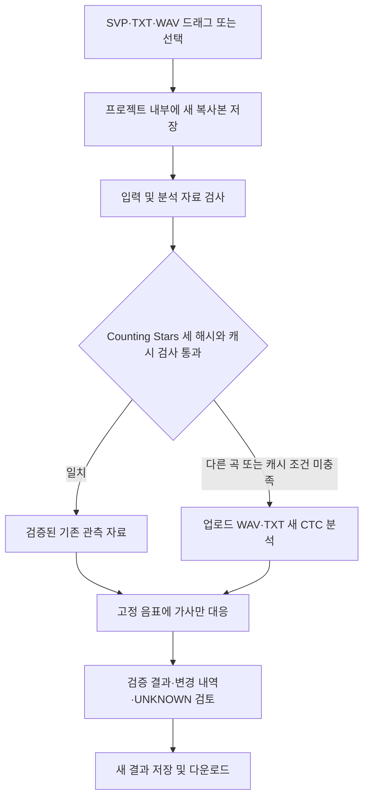

# Gradio GUI 구현 계획

상태: **GUI 음표 고정·가사 전용 계약, 모델 선택에 이어 연속 음표 구간 배치·기호 검증·초안 교정과 품질 분류를 구현했다.** 최종 검증은 [가사 배치 개선 기록](lyrics-placement-improvement-plan.md#8-구현과-검증-기록)을 따른다. 큰 모델 선택 당시 154개 검사 및 Large/Qwen CUDA 실행은 이전 이력이다. 갱신일: 2026-11-15.

Run Boy Run의 원본 `la` 잔존, 단어 미배치와 기호 연결 위험에 대한 개선을 일반 곡 경로에 적용했다. 미완성 초안 저장은 허용하되 미대응과 배치 후 검토를 나누며 전체 가창 대응은 NOT_VERIFIED를 유지한다. Counting Stars 기존 분석 옵션은 이전 대응을 유지하고 세부 품질 미상·교정 비활성으로 표시한다. 이전 154개 통과를 새 개선이나 실제 가창 정확도의 완료 근거로 사용하지 않는다.

이 문서는 로컬 Windows 환경에서 **기존 SVP 음표를 유지한 채 가사만 넣는** Gradio 화면의 계약과 완료 기준을 정한다. 초기 Counting Stars 전용 GUI와 일반 곡 분석은 타이밍 수정도 수행했으나, 현재 GUI는 사용자 요청에 따라 `lyrics`만 변경한다. 음표 시작·길이·음높이·개수·순서와 나머지 필드는 원본과 같아야 한다. 실제 배치와 검증 결과는 [구현 기록](gradio-gui-implementation.md)에 정책 변경 전후로 구분해 기록한다. 기존 Counting Stars 타이밍 조정 CLI, 독립적인 피치·파형 검증, 번역과 합성은 각각 별도 범위다.

기준은 [AGENTS.md](../AGENTS.md)와 [프로젝트 스킬](../.agents/skills/svp-vocal-alignment/SKILL.md)이다. GUI의 변경 범위에는 이후 사용자가 지정한 **음표 유지·가사만 입력** 계약을 우선 적용한다. 현재 사용법은 [README](../README.md), 환경 검증 기록은 [python-environment.md](python-environment.md), 기존 타이밍 조정 CLI의 곡별 요구사항은 [Counting Stars 명세](counting-stars-vocal-alignment.md)를 참고한다. 실행 방법은 README의 Gradio GUI 실행 절을 따른다.

## 1. 현재 프로그램과 제약

| 현재 담당자 | 확인한 동작 | GUI 연결 시 의미 |
| --- | --- | --- |
| [jobs/processing.py](../svp_alignment/jobs/processing.py), [general_pipeline.py](../svp_alignment/general_pipeline.py), [cached_lyrics.py](../svp_alignment/cached_lyrics.py) | 명시한 모델 선택에 따라 새 WAV·TXT 분석과 검증된 Counting Stars 기존 자료를 구분 | 두 GUI 경로 모두 기존 음표에 `lyrics`만 적용한다. 다른 곡에 Counting Stars 캐시·음절 정책을 사용하지 않는다. |
| [audio/alignment.py](../svp_alignment/audio/alignment.py), [worker.py](../svp_alignment/audio/worker.py) | 선택 모델을 작업별 별도 프로세스로 실행하며 강제 정렬 관측 이력과 실제 프로세스 수명을 관리 | 언어와 모델 선택이 작업에 바인딩되는 새 분석 경로다. |
| [run.py](../work/counting_stars/run.py) | 원본 검증 → 저장된 분석 자료 읽기 → 가사 대응 → 시간 보정 → SVP·비교표·보고서 생성 | 기존 분석 자료를 이용한 결과 생성 진입점이다. 새 음성 분석을 실행하지 않는다. |
| [ctc_words.py](../work/acoustic/ctc_words.py) | CTC 두 모델의 문자·단어 시각 JSON 및 emissions NPY 생성 | 재분석 시 모델·GPU·캐시 수명과 쓰기 경로를 별도로 관리해야 한다. |
| [analyze_pitch.py](../work/pitch/analyze_pitch.py), [candidate_boundaries.py](../work/pitch/candidate_boundaries.py) | 원본 보컬과 연결된 잔향 제거 WAV의 프레임 분석, 음표 경계 CSV 생성 | 전체 기존 분석에는 추가 연결 WAV도 필요하다. 세 파일만으로 항상 재현된다고 가정하지 않는다. |
| [whisper_words.py](../work/acoustic/whisper_words.py), [targeted_asr.py](../work/acoustic/targeted_asr.py) | 전체·국소 인식 결과를 검토 자료로 생성 | 현재 run.py가 직접 읽는 필수 입력은 아니다. |

기존 타이밍 조정 CLI run.py의 직접 분석 입력은 `work/acoustic/en_ctc_words.json`, `work/acoustic/mms_ctc_words.json`, `work/pitch/pitch_boundary_candidates.csv`, `work/pitch/source_frames.csv`다. 재생성 중 WAV는 원본 해시·길이·채널·샘플레이트 확인에 사용된다. GUI의 Counting Stars 어댑터는 검증된 가사 대응만 적용하며 CLI의 타이밍 계산을 호출하지 않는다. GUI에서 기존 자료를 읽은 작업을 새 WAV 분석이나 새 청취 검증으로 표시하지 않는다.

기본 자동 모델은 Counting Stars를 포함해 모든 입력에 새 분석 경로를 사용한다. 기존 자료를 재사용하려면 모델에서 Counting Stars 기존 분석 자료를 명시적으로 선택한다. 이 경로만 파일명, 원본 세 파일의 SHA-256, 715개 음표, 120 BPM, 262.56초 WAV, 527단어·81행 TXT와 수동 정책을 고정 검증한다. 선택한 입력이나 외부 연결 오디오·관측 자료가 조건에 맞지 않으면 실패 사유를 표시하고 중단한다. 다른 모델로 자동 전환하지 않는다. 기존 CLI의 엄격한 검증 계약은 바꾸지 않는다. 새 분석 경로는 실제 SVP 참조·템포·오프셋과 TXT·WAV를 검사한다. Gradio 진입점은 루트 app.py다. 번역과 보컬 합성은 후속 범위다.

### 입력 파일명 차이

| 최신 AGENTS.md의 계약 | 현재 코드·기존 명세의 파일명 |
| --- | --- |
| `OneRepublic - Counting Stars 여자 커버(1).svp` | `OneRepublic - Counting Stars 여자 커버.svp` |
| `OneRepublic - Counting Stars(1).txt` | `OneRepublic - Counting Stars.txt` |
| `1_OneRepublic - Counting Stars_(Vocals)(1).wav` | `1_OneRepublic - Counting Stars_(Vocals).wav` |

현재 원본 폴더에는 기존 파일명 세트가 있으며 고정 프로필 해시와 일치함을 확인했다. `(1)` 세트는 해당 폴더에 없어 직접 대조하지 않았다. GUI는 업로드된 원래 파일명을 보존하고 계약 파일명과의 차이를 경고한다. 명시적으로 선택한 원본의 해시·프로젝트 구조·분석 자료 대응을 검사한다. 파일명을 바꾸거나 기존 해시 검증을 제거하는 방법으로 차이를 숨기지 않는다. 이 파일명 표는 Counting Stars의 기존 고정 계약에만 해당한다. 세 파일 해시가 기존 프로필과 다르면 일반 곡으로 검사하며, 이전 Counting Stars 관측 자료를 해당 입력에 재사용하지 않는다.

## 2. 구현 범위와 순서

| 단계 | 제공할 기능 | 다음 단계로 넘어가는 기준 |
| --- | --- | --- |
| 완료: 기존 GUI와 업로드 | Counting Stars 기존 자료·CLI 호환, 드래그 보관, 비교·UNKNOWN 검토·다운로드·작업 복구 | 초기 구현과 업로드 전송 검증 이력 유지 |
| 이전 구현: 새 CTC 분석과 여러 곡 | 다른 SVP·TXT·WAV의 새 강제 정렬. 가변 템포·참조 오프셋, 언어 선택, 모델 캐시·작업 프로세스·취소·관측 이력 | 타이밍 수정이 포함된 Shooting Stars 영어 전체 처리·게시와 당시 116개 검사는 역사 기록으로 보존 |
| 완료: 음표 고정·가사 전용 | 새 GUI 작업 `operation=lyrics_only`, 두 분석 경로 모두 `lyrics`만 적용, LYRICS_FILLED 결과명, 이전 미완료 작업 차단 | 전체 127개 검사·pip check, 새 Shooting Stars의 lyrics 외 전 필드 동일성, 새·이전 완료 작업 복원 확인 |
| 후속: 독립 관측과 기능 확장 | 실제 청취·피치/파형 경계 검증, 대상 트랙 선택·공유 그룹 편집, 번역·합성 등 | 각 기능의 입력·자원·보존 계약과 실제 결과를 별도 검증 |

현재 작업은 제공된 TXT와 보컬 WAV를 **고정된 기존 음표**에 대응시키는 자동 가사 후보 생성이다. 관측한 발음 시각은 대응 근거이며 음표 시작·길이를 수정하지 않는다. 언어와 AI 정렬 모델을 선택한다. 기본 자동 모델은 영어 또는 언어 자동의 ASCII 알파벳 가사에 Wav2Vec2 Large, 지원 비영어를 명시하면 Qwen, 비ASCII 자동 언어·다국어에는 MMS를 사용한다. Qwen을 직접 선택한 비ASCII 가사는 지원 언어를 명시해야 하며 WAV는 300초 이하여야 한다. 첫 모델 다운로드와 진행 상태는 화면에 표시한다. 모델별 선택·환경·캐시·미수행 검증은 구현 기록의 큰 모델 절에 구분한다. 원문에 없는 가사의 작성, 일본어→한국어 번역, 보컬 합성·렌더링, 원격 공개는 후속 범위다. 현재 교정은 제공된 원문 토큰·음절·지속음의 기존 음표 대응만 수정한다.

## 3. 화면과 사용자 흐름

| 화면 영역 | 입력·표시 내용 | 동작 계약 |
| --- | --- | --- |
| 입력 | 원본 SVP·TXT·보컬 WAV 각각의 파일 업로드 칸과 가사 언어·분석 모델 | 드래그 또는 파일 선택 직후 프로젝트 내부에 새 복사본을 저장한다. 같은 이름도 덮어쓰지 않고 외부 원본은 읽기 전용으로 둔다. |
| 입력 검사 | 트랙·보컬 그룹, 음표 수, 템포·오프셋, WAV 정보, 가사 행·단어 수, 분석 자료 사용 가능 여부 | 지원 조건을 서버에서 검사한다. 여러 그룹 중 대상이 모호하면 임의로 첫 그룹을 고르지 않는다. |
| 작업 실행 | 실행 버튼, 현재 단계·진척, 오류·취소 상태 | 새 분석과 기존 관측 자료 사용을 구분한다. 모델·파일이나 언어가 바뀌면 이전 검사·결과와 연결을 끊고 다시 검사한다. |
| 결과 검토와 교정 | 원본과 같은 시작·길이, 가사·원문 위치, 배치 행동·검토 상태·미배치·기호 위험 | 비교표는 읽기 전용이고 별도 교정기에서 단어·+/−와 확인 상태만 변경한다. 초안 버전·입력 서명 검증 후 재검증하며 타이밍은 수정하지 않는다. 원본 WAV 구간 듣기를 제공한다. |
| 결과 저장 | 새 SVP, 음표 비교 CSV, 가사 검증 CSV, Markdown 보고서의 경로·다운로드 | 검증된 해당 작업 결과만 전달한다. 파일 파싱과 실제 Studio 열기, 합성 재생 상태는 각각 구분한다. |

입력은 세 개의 `gr.File(type="filepath")` 업로드 칸으로 받는다. `UploadStore`가 업로드 직후 원래 파일명을 보존해 `work/uploads/<uuid>/<원래 파일명>`에 바이트 그대로 복사한다. 각 업로드는 고유 디렉터리를 사용하며 검사·계산은 보관본을 읽는다. Gradio 임시 업로드 경로를 영구 입력으로 기록하거나 사용자의 원래 Windows 경로로 취급하지 않는다. 업로드 이름으로 외부 원본 디렉터리를 추측하지 않는다. 파일 교체·제거 시 이전 작업 연결과 결과 표시를 해제하고 다시 검사한다. [Gradio File 문서](https://gradio.app/docs/gradio/file)

WAV 분석은 원본 바이트를 사용한다. `gr.Audio`는 미리듣기 용도로 사용하며, 컴포넌트의 변환·정규화 결과를 원본 분석 입력으로 덮어쓰지 않는다. 실제 선택한 Gradio 버전에서 오디오 반환 형식과 파일 보존 동작을 확인한다. [Audio 문서](https://gradio.app/docs/gradio/audio)

## 4. 입력·작업·결과 계약

### 입력과 관측 자료

- 각 새 GUI 작업은 `input_summary.operation="lyrics_only"`와 원본 SVP·TXT·WAV 경로, 선택 그룹과 곡별 설정, 원본 해시, 분석 자료 해시·설정, 결과 위치를 식별 가능한 입력 기록으로 갖는다. 모드가 cached Counting Stars인지 일반 곡인지는 가사 전용 계약을 바꾸지 않는다.
- GUI의 입력 경로는 업로드 담당자가 만든 프로젝트 내부 보관본의 경로다. 사용자가 입력하는 로컬 경로 텍스트 필드는 제공하지 않는다. CLI의 기존 경로 지정 계약은 유지한다.
- SVP 내부의 오디오 경로 문자열을 변경하지 않는다. 일반 곡은 연결 파일 부재·원래 상대 경로 해석 불가를 경고하고 업로드 WAV를 독립적으로 분석한다. 결과 SVP의 기존 오디오 연결은 사용자가 확인해야 한다. Counting Stars 기존 자료 옵션의 연결 오디오·상대 경로 검사는 사용 조건으로 유지하며 조건 미충족 시 사유를 표시하고 중단한다. 기존 CLI의 검사·실패 계약은 그대로다.
- 단일 보컬 트랙의 mainGroup 또는 참조 라이브러리 그룹을 처리하며 가변 템포와 그룹 blickOffset·프로젝트 startTimeSeconds를 적용한다. 여러 보컬 트랙의 대상 모호성, 공유 그룹의 다중 참조, 참조 범위로 잘린 음표와 정렬되지 않은 원본 음표 순서는 명확한 오류로 중단한다.
- 분석 모델이 찾은 발음 시각과 기존 음표 시각이 다르더라도 음표를 이동하거나 늘이거나 줄이지 않는다. 불확실한 가사 대응은 UNKNOWN으로 보고하며 원본부터 참조 범위로 잘린 미지원 음표는 오류로 안내한다.
- 연결 오디오 참조가 하나면 그 시작을 업로드 WAV 원점으로 가정해 audio_offset을 적용한다. 하나로 정할 수 없으면 WAV 0초=프로젝트 0초를 가정하고 경고한다. 미리듣기 좌표는 WAV 기준 초다. 이 가정은 실제 원점 검증을 대신하지 않는다.
- 가사 토큰·음절·반복 회차와 음표 식별자를 연결한다. 대상 그룹의 원본 UUID 또는 원본 인덱스를 보존하고 mainGroup.notes가 비어 있어도 실제 참조 그룹을 확인한다.
- 새 분석 자료에는 입력 WAV·TXT 해시·요청 서명, 선택값 model_choice·해결된 model_id·가중치 SHA-256, 분석 설정·버전·실제 장치를 기록하고 작업 입력 기록에 SVP 해시와 오디오/그룹 오프셋을 남긴다. 기존 캐시의 파일명·프레임 개수만으로 새 입력에 재사용하지 않는다.
- 기존 자료 재사용은 Counting Stars 기존 자료 옵션을 명시하고 검증된 입력 프로필과 자료의 대응을 확인한 경우에 한정한다. 자동 모델은 정확히 같은 Counting Stars 입력도 새 분석한다. 이력 확인이 부족한 항목을 새로 분석한 결과처럼 보고하지 않는다.
- 모델 선택 없는 이전 READY/REVIEW_READY 등 미완료 작업은 실행·저장을 거절하고 재검사를 요구한다. COMPLETED 결과는 기존 파일을 그대로 유지하고 실제 기록된 모델을 표시·복원한다. 모델 선택을 새 기본값으로 바꾸어 이전 계산을 이어 가지 않는다.

### 작업 수명과 자원

작업 상태는 `CREATED → VALIDATING → READY → RUNNING → REVIEW_READY → EXPORTING → COMPLETED`를 기본으로 하며, 실패는 `FAILED`, 취소 요청과 완료는 `CANCEL_REQUESTED`, `CANCELLED`로 구분한다. 예상 밖 오류에도 처리 단계와 사용자에게 설명할 사유를 남긴다. 서버 재시작으로 중단된 작업을 완료로 복원하지 않는다. `lyrics_only`가 없는 이전 미완료 작업은 실행·저장을 거절하고 세 파일을 다시 업로드해 검사하도록 안내한다. 이전 COMPLETED는 타이밍 수정 작업으로 명확히 표시해 기존 결과·미리듣기만 복원하며 재계산·재저장하지 않는다.

업로드 담당자는 `work/uploads/<uuid>/`에 파일을 보관한다. 파일명은 입력 경로를 만드는 용도로 그대로 신뢰하지 않고 보관 경계를 확인하며, 매 업로드마다 새 UUID 디렉터리를 만든다. 복사가 성공한 경로는 서버의 `InputSelectionRegistry`가 브라우저 세션·파일 종류별로 보관한다. 레지스트리는 현재 Gradio 파일 값과 보관본 경로를 연결하고 세대 토큰으로 늦게 끝난 복사가 이전 선택을 되살리지 못하게 한다. 입력 교체·제거는 이전 작업을 무효화하지만 보관된 원본 복사본을 삭제하지 않는다. 작업 manifest에는 보관본 경로와 해시를 남겨 새로고침·서버 재시작 뒤 작업 ID 복구에도 같은 파일을 사용한다.

`work/gradio/<job_id>/`를 작업별 계산·초안·기록 위치로 사용한다. `<job_id>`는 서버가 생성하고 사용자 파일명에서 경로로 만들지 않는다. 기존 `work/acoustic`·`work/pitch` 관측 자료는 Counting Stars 경로에서 읽기 전용으로 참조한다. 일반 곡 관측 결과와 request/progress/error/process/runtime 기록은 해당 작업의 `audio/` 아래에 둔다. CTC 모델은 `work/models/torchaudio/`와 기존 지원 캐시에서, Qwen은 고정 revision의 `work/models/qwen/`에서 읽는다. 새 다운로드는 고유 임시 파일을 거쳐 게시하고 기존 모델을 덮어쓰지 않는다. 새 분석이 공유 파일을 덮어쓰지 않도록 작업 디렉터리를 명시적으로 전달한다. 이 폴더들은 실제 구현에서 파일이 필요할 때 생성한다.

두 개의 `gr.State`에는 작업 ID와 현재 File 값·언어·모델 선택의 입력 서명만 둔다. 선택한 보관본 경로는 별도 서버 레지스트리가 소유한다. 작업 복구는 File 위젯을 비우고 선택 레지스트리를 초기화하며, manifest에 기록한 입력으로 기존 작업을 계속하고 언어·모델 선택도 복원한다. 새 입력 검사를 하려면 파일 세 개를 다시 올린다. 이 값은 서버의 세션 값이며 브라우저 localStorage와 구분한다. 모델, 파일 핸들, Lock, 실행 프로세스는 서버의 작업 실행 담당자가 소유한다. 일반 곡은 별도 worker 프로세스가 모델 로딩·추론·CUDA 자원을 소유하고, 음성 분석 담당자가 실제 프로세스 종료까지 작업 간 FileLock을 유지한다. Windows에서는 venv 리다이렉터가 자식을 남기지 않도록 실제 인터프리터에 프로젝트와 해당 가상환경 패키지만 주입하는 격리 부트스트랩을 사용한다. UI 새로고침과 서버 작업·저장 결과의 수명을 분리하고, 보관 중인 작업 기록에서 결과를 다시 조회할 수 있게 한다. Gradio Queue의 제한이 callback 반환 후에도 별도 프로세스의 수명을 자동 보호하지는 않는다. callback이 작업 종료까지 대기하거나 서버 실행 담당자가 프로세스 종료까지 GPU 작업의 직렬화를 소유해야 한다.

취소는 대기 제거와 실행 중단을 구분한다. 일반 곡 분석은 취소 요청을 확인하면 실제 worker를 종료·대기하고 필요한 경우 강제 종료 후 다시 대기한다. 작업 프로세스를 종료할 때는 종료 확인과 자원 회수까지 상태를 추적한다. 실패·취소된 초안과 부분 캐시는 완료 결과에 포함하지 않으며 다른 작업 자료를 정리 대상으로 삼지 않는다.

### 결과 저장과 보존

GUI의 최종 결과 폴더는 `outputs/<job_id>/`다. **새 GUI 결과는 Counting Stars를 포함해 모두 원본 SVP stem에 `_LYRICS_FILLED.svp`를 붙인다.** 비교 자료는 ` - Note comparison.csv`, ` - Lyric verification.csv`, ` - Verification.md`를 붙인다. 기존 CLI의 outputs 위치와 `_TIMING_FIXED.svp` 고정 결과명은 호환성을 위해 유지한다. 이전 GUI의 TIMING_FIXED 결과 파일과 계산 내용은 새 정책 결과로 덮어쓰지 않으며, 이전 COMPLETED 파일 내용도 보존한다. 작업 상태 manifest에는 재검사 요구나 중단에 따른 FAILED 상태를 기록할 수 있다. 일반 곡의 기존 상대 오디오 경로 해석 경고를 결과 이력에도 보존한다.

결과 담당자는 작업별 초안에 SVP·CSV 2개·보고서를 생성한다. 초안 저장 전·재파싱 후·게시 직전에 **모든 음표에서 `lyrics` 외 필드와 나머지 프로젝트 전체가 원본과 정확히 같은지** 검사한다. `onset`·`duration`도 완전 동일해야 하며 음표 추가·삭제·재정렬을 허용하지 않는다. 검증 후 새 대상 폴더에 전달한다. 저장 중 일부 파일만 생성됐으면 완료 상태나 다운로드 목록을 공개하지 않는다. 기존 폴더·파일이 있으면 덮어쓰지 않는다. 현재 CLI의 파일별 rename을 전체 결과의 원자적 저장이라고 표현하지 않는다.

GUI는 허용된 해당 작업의 결과 경로만 반환한다. 기본 실행 주소는 `127.0.0.1`, 공개 링크는 비활성화한다. 프로젝트 루트나 외부 원본 폴더 전체를 파일 제공 경로로 등록하지 않는다. `allowed_paths` 외에도 업로드·캐시 파일 및 함수가 반환하는 파일이 제공될 수 있으므로, 빈 allowed_paths만으로 접근이 제한된다고 가정하지 않는다. [Blocks launch](https://gradio.app/docs/gradio/blocks), [파일 접근 규칙](https://gradio.app/guides/file-access)

## 5. 책임 경계와 실제 코드 배치

1차 구현은 `svp_alignment` 패키지로 정렬 계산, 검증, 작업 수명, 게시, 화면을 분리했다. [구현 기록의 책임 이전표](gradio-gui-implementation.md#책임-이전과-배치)에 출발·도착 경로, 상태·쓰기·수명, 실제 호출자와 호환 검증을 기록했다.

- 곡 라우팅: `jobs/processing.py`. GUI 캐시 가사 대응: `cached_lyrics.py`. 일반 곡 가사 대응: `general_pipeline.py`, `general_prepared.py`, `alignment/general_lyrics.py`, `alignment/general_matching.py`. GUI는 `time_notes`를 호출하지 않는다. 기존 CLI의 시간 보정은 `pipeline.py`, `prepared_alignment.py`, `alignment/timing.py` 등 기존 경로에 유지한다.
- 일반 SVP 형식과 시간 변환: `project/document.py`, `project/tempo_map.py`.
- 새 음성 분석: `audio/model_catalog.py`(선택·언어 정책), `alignment.py`(프로세스 수명), `worker.py`(격리 실행), `models.py`(CTC 모델 캐시와 Qwen 위임), `qwen_cache.py`(고정 snapshot), `waveform.py`(WAV 변환), `transcript.py`(원문·모델 텍스트), `inference.py`(CTC 계산), `qwen_inference.py`(Qwen 단어 관측).
- 판정·표현: `verification/`. 가사 전용 엄격 보존 검사는 `verification/lyrics_only.py`가 소유한다.
- 업로드 보관·작업 상태·세션·미리듣기·결과 게시: `jobs/`. [uploads.py](../svp_alignment/jobs/uploads.py)의 `UploadStore`가 파일 쓰기를, [input_selection.py](../svp_alignment/jobs/input_selection.py)의 `InputSelectionRegistry`가 세션별 선택과 세대 토큰을 소유한다.
- Gradio 화면·콜백·표현: `ui/`. [upload_callbacks.py](../svp_alignment/ui/upload_callbacks.py)가 File 위젯의 사용자 `.upload`·`.clear` 이벤트를 보관·선택 담당자에게 위임한다. File의 `.change`는 사용하지 않는다. 일반 작업 콜백은 현재 선택을 보관본 경로로 해석한 뒤 기존 JobManager API에 전달한다. 시작 환경과 서버 실행은 루트 `app.py`.
- 기존 CLI: `cli.py`, `legacy.py`와 기존 `work/counting_stars` 호환 진입점.

기존 GUI·업로드와 일반 곡 확장의 구조 판정·116개 회귀 검사는 정책 변경 전 이력으로 보존한다. 가사 전용 계약의 책임 경계와 기존 검증은 [가사 전용 변경 기록](gradio-gui-implementation.md#음표-고정가사-전용-변경)에, 신규 모델 선택 경계·검증은 [큰 모델과 GUI 모델 선택](gradio-gui-implementation.md#큰-모델과-gui-모델-선택)에 기록한다. 기존 Counting Stars acoustic/pitch 스크립트는 이동하거나 재구성하지 않았다.

모델 선택 확장 전 가사 전용 변경의 신규 담당자는 `cached_lyrics.py`와 `verification/lyrics_only.py`로 분리했고, 처리 흐름·작업 수명·파일 게시·화면의 기존 경계는 유지했다. 실제 호출·소유권·배치 및 기존 CLI 호환을 확인했으며 구조 판정은 완료했다. 전체 127개 회귀 검사와 프로덕션/app Python 51개 정적 검사가 통과했다.

## 6. Gradio 연결과 의존성 계획

| 항목 | 구현 계약 | 공식 근거 |
| --- | --- | --- |
| Blocks와 이벤트 | 입력 검사, 실행, 검토, 저장을 별도 이벤트로 연결. 버튼 상태 외에도 서버에서 현재 입력과 작업 상태를 확인 | [Blocks](https://gradio.app/docs/gradio/blocks), [Button](https://gradio.app/docs/gradio/button) |
| State | 두 개의 작은 값인 작업 ID·파일/언어/모델 입력 서명만 저장. 보관본 경로 선택은 서버 레지스트리, 복구용 입력 기록은 manifest가 소유 | [State 가이드](https://github.com/gradio-app/gradio/blob/main/guides/03_building-with-blocks/03_state-in-blocks.md) |
| Queue | 대기열 크기를 정하고 GPU 이벤트가 동일 concurrency_id와 concurrency_limit=1을 공유하도록 구성. 서로 다른 이벤트가 같은 GPU에 동시에 들어가는 경우도 검사 | [Queue 설정](https://gradio.app/docs/gradio/blocks), [이벤트 동시성](https://gradio.app/docs/gradio/button) |
| Progress | 실제로 측정한 단계·청크 진척만 전달. 총량이 없으면 단계명으로 표시 | [Progress](https://gradio.app/docs/gradio/progress) |
| 취소 | cancels만으로 실행 중 일반 함수를 강제 중단할 수 없다. 서버 취소 요청과 단계별 확인·작업 프로세스 정리 필요 | [cancels 계약](https://gradio.app/docs/gradio/button) |
| Dataframe | 읽기 전용 비교표와 배치 행동·검토·미배치·기호 위험 필터. 선택은 별도 가사 교정기에 연결 | [Dataframe](https://gradio.app/docs/gradio/dataframe) |

초기 환경에서는 Python 3.10과 기존 분석 의존성 버전을 제약 조건으로 resolver를 확인한 뒤 Gradio 6.17.3을 설치했다. 일반 곡 다국어 정렬에 uroman 1.3.1.1을 추가했으며 requirements에는 기존 버전을 보존한 런타임 69개를 고정했다. pip check, 앱 구성, 콜백과 로컬 서버 접속을 확인했다. 실제 브라우저 조작은 도구의 현재 URL 확인 실패로 중단돼 NOT_RUN이다. 배포 버전의 실제 Blocks·컴포넌트·이벤트 API로 구성 검사했다.

큰 모델 선택 확장에서는 같은 .venv에 Qwen 런타임 28개를 추가해 총 97개를 requirements에 고정했다. 기존 설치 버전 변경은 없으며 신규 pip check와 Qwen import·영/한/일 토큰화가 통과했다. 모델 선택·관측·보존 집중 41개, 음성 백엔드 25개와 UI/ASGI 27개를 통과했으며 이 묶음을 단순 합산해 전체 테스트 수로 사용하지 않는다. 최종 전체 154개 검사(70.019초)와 Large/Qwen의 실제 CUDA 전체 곡 추론을 통과했으며, 구현 기록의 새 모델 절에 입력·관측·음표 전체 보존과 미확정 대응을 별도 기록한다.

## 7. 구현 완료와 검증 기준

| 대상 | 확인할 결과 |
| --- | --- |
| 입력 | 공백·한글 파일명의 업로드, 원래 바이트 보존, 같은 이름의 재업로드 격리, 교체·제거 시 작업 무효화, 보관 경로 탈출 차단. 없는 파일·잘못된 형식·다른 해시·자료 조합을 안내 |
| 원본 보존 | 원본 SVP·TXT·WAV 및 기존 분석 자료·결과의 해시가 작업 전후 같음 |
| 가사 대응과 음표 고정 | 가사 순서·반복·누락을 복원해 검사. 모든 음표의 onset·duration·pitch·detune·ID·순서·개수와 그 밖의 모든 필드, 나머지 프로젝트 전체가 동일. `lyrics`만 변경 가능 |
| 발음 관측 근거 | 기존 기준점과 새로 관측한 기준점을 구분. 발음 시각은 가사 대응 참고값으로만 사용하며 타이밍 수정 금지. 근거 부족은 UNKNOWN으로 남김 |
| 이전 작업 복구 | 이전 COMPLETED는 타이밍 수정 작업으로 표시하고 기존 결과 복원. 이전 미완료 READY/REVIEW_READY 등의 실행·저장은 거절하고 재검사 안내 |
| CLI 호환 | --source/--output/--studio-status/--report-only, 기본 경로·결과명·stdout JSON과 기존 실패 조건 유지 |
| 보고서 전용 모드 | --report-only의 기존 SVP 동일성·검증 대기 보고서 확인 후 갱신이라는 예외 계약 보존. GUI의 일반 저장 버튼과 혼합하지 않음 |
| 동시 실행·취소 | 같은 GPU의 작업 직렬화, 세션별 상태·파일 격리, 단계 중 실패·취소 시 완료 결과 미공개, 작업 프로세스·파일 자원 정리 |
| 저장 실패 | 충돌·쓰기 실패·부분 전달 시 기존 결과 보존. 검증되지 않은 초안을 최종 결과로 표시하지 않음 |
| 브라우저 | localhost에서 실제 입력→검사→실행→검토→다운로드 확인, 새로고침 후 남은 작업·결과의 상태 확인 |
| SVP 실제 검증 | 파싱과 Studio Pro 실제 열기를 별도 판정. 실제 열기·합성 재생을 수행하지 않았으면 NOT_RUN과 사유를 기록 |

UI에서 모든 항목을 단일 성공 배지로 합치지 않는다. 특히 기존 CLI의 studio-status 자유 문자열을 GUI의 자동 PASS 근거로 사용하지 않는다. 미배치 가사와 UNKNOWN이 남으면 결과와 함께 표시하고, 전체 가창 정렬 검증이 남은 경우 NOT_VERIFIED를 유지한다.

정책 변경 전 이력: 초기 1차 구현 24개, 업로드 변경 후 52개, 일반 곡 확장 중 108개와 당시 최종 116개 회귀 검사 및 pip check가 통과했다. 기존 CLI 네 파일은 변경 전과 바이트 단위로 일치했다. Shooting Stars 전체 WAV의 실제 영어 CTC 실행도 **이전 타이밍 수정 정책**으로 수행한 결과이며, 음표 고정 결과의 검증 근거로 사용하지 않는다. 신규 가사 전용 검증은 [별도 기록](gradio-gui-implementation.md#음표-고정가사-전용-변경)에 있다. 실제 브라우저 화면, 전체 WAV 청취, Studio 열기·보컬 합성과 MMS 실제 가창 추론·CPU 전체 추론은 NOT_RUN이다.

모델 선택 확장 전 가사 전용 정책: 전체 **127개 검사(64.526초)**와 pip check가 통과했다. Shooting Stars를 새 작업으로 실제 CUDA 분석해 onset·duration·pitch 변경 0개, lyrics 변경 263개와 나머지 JSON 전체 동일성을 확인했다. 이전 결과를 덮어쓰지 않고 LYRICS_FILLED SVP와 검증 자료를 새 폴더에 게시했다. 자동 가사 대응의 UNKNOWN과 미배치가 남아 전체 가창 대응은 NOT_VERIFIED다.

큰 모델 선택 확장: 영어 기본 Large와 선택 Qwen 모두 Shooting Stars 전체 WAV를 실제 CUDA에서 처리하고 새 LYRICS_FILLED 결과를 게시했다. 두 모델 모두 모든 음표의 onset/duration/pitch 변경 0개와 lyrics 외 JSON 전체 동일성을 확인했다. 최종 154개 회귀 검사·pip check·기존 CLI 호환·기존 파일 보존이 통과했다. 가사 배치는 Large 229/240단어, Qwen 124/240단어이며 가창 정확도 개선으로 확정하지 않는다. UNKNOWN·미배치 검토와 실제 청취·Studio 열기·합성은 별도이고 전체 가창 대응은 NOT_VERIFIED다.
